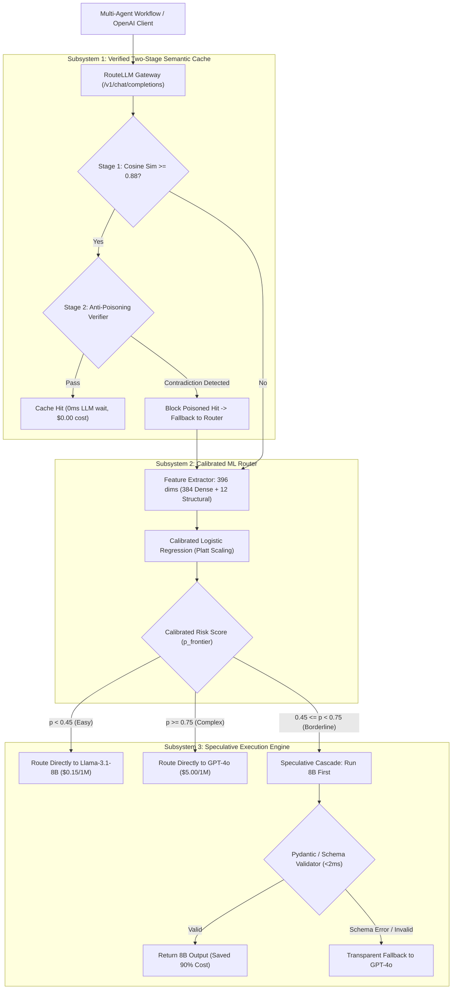

# Model-Router: Practice Prototype & Proof of Concept (Phase 1)

> **Context for Readers & Reviewers:**  
> This directory contains the **initial educational prototype and proof-of-concept** for Model-Router. Before building the production-grade multi-tier gateway on real model outputs, we created this prototype to hands-on validate core ML and systems engineering hypotheses in a controlled, local environment.

---

## 1. Why Was This Practice Prototype Created?

When designing a cost-aware LLM router and gateway, there were four core engineering questions we needed to empirically answer before scaling:

1. **Is Semantic Cache Poisoning a Real Vulnerability?**  
   Most tutorials use a naive cosine similarity cache. We needed to test whether contradictory prompts (*"Delete production database"* vs *"Do NOT delete production database"*) fool bi-encoders.
2. **How Do We Build Deterministic Evaluation Without Label Noise?**  
   We explored how to simulate and grade model failures using explicit structural constraints (nested schemas, concurrency locks, arithmetic drift) rather than stochastic coin flips.
3. **Can We Achieve Calibrated Routing Within a 10ms Latency Budget?**  
   We engineered a 396-dimensional hybrid feature extractor (384 dense semantic + 12 structural complexity signals) paired with an $L_2$-regularized Logistic Regression model wrapped in **Platt Scaling** to ensure predicted risk matches true empirical failure rates.
4. **How Does an OpenAI-Compatible Speculative Cascade Operate?**  
   We implemented an end-to-end FastAPI proxy (`/v1/chat/completions`) that can speculate with cheap models on borderline queries, validate with Pydantic in $<2\text{ ms}$, and fallback seamlessly.

---

## 2. Prototype System Architecture



---

## 3. What Was Discovered in the Prototype Labs?

### Lab 1: Exposing Semantic Cache Poisoning (`notebooks/01_cache_poisoning_exp.ipynb`)
- **Finding:** Contradictory prompt pairs scored **`0.930` to `0.998`** cosine similarity on standard Bi-Encoders (`all-MiniLM-L6-v2`).
- **Result:** Single-stage semantic caches suffered an **`83.3%` Cache Poisoning Rate** at standard thresholds ($\tau = 0.85$).
- **Conclusion:** Single-stage vector caching is fundamentally broken for mission-critical prompts; a two-stage verifier is required.

### Lab 2: Deterministic Oracle Benchmarking (`notebooks/02_oracle_data_gen.ipynb`)
- Built a 600-sample balanced dataset across 5 difficulty domains (`factual_qa`, `text_formatting`, `code_engineering`, `json_schema`, `math_logic`).
- Modeled deterministic failure triggers (schema nesting depth $\ge 2$, concurrency race conditions, multi-constraint arithmetic).

### Lab 3: Feature Engineering & Platt Calibration (`notebooks/03_train_and_calibrate.ipynb`)
- Combined 384 dense embeddings with 12 structural signals into a 396-dim hybrid representation.
- Proved that structural signals like `multi_constraint_count` and `char_length` exert **$10\times$ to $20\times$ higher odds leverage** ($e^w$) on failure prediction than individual semantic embedding dimensions.
- Trained an $L_2$ Logistic Regression classifier with 5-fold cross-validation and Platt Scaling, achieving a **Brier calibration loss $< 0.05$** and sub-10ms routing overhead.

---

## 4. The Prototype Pareto Frontier

Sweeping the routing threshold $\tau$ on our prototype benchmark produced this efficiency curve:

| Threshold ($\tau$) | Route to Small (%) | Route to Frontier (%) | System Accuracy (%) | Retained Accuracy (%) | Total Cost ($) | Cost Savings (%) |
| :---: | :---: | :---: | :---: | :---: | :---: | :---: |
| **0.00** *(Always Frontier)* | 0.0% | 100.0% | 100.0% | 100.0% | $1.5000 | Baseline (0.0%) |
| **0.10** | 40.0% | 60.0% | 100.0% | 100.0% | $0.9180 | 38.8% |
| **0.20** | 40.0% | 60.0% | 100.0% | 100.0% | $0.9180 | 38.8% |
| **0.30 - 0.70 (Optimal)** | **45.0%** | **55.0%** | **100.0%** | **100.0%** | **$0.8453** | **43.6%** |
| **0.80** | 46.7% | 53.3% | 98.33% | 98.33% | $0.8210 | 45.3% |
| **0.90** | 51.7% | 48.3% | 93.33% | 93.33% | $0.7482 | 50.1% |
| **1.00** *(Always Small)* | 100.0% | 0.0% | 45.0% | 45.0% | $0.0450 | 97.0% *(Broken)* |

---

## 5. Prototype Directory Structure

```text
practice/
├── notebooks/
│   ├── 01_cache_poisoning_exp.ipynb    # Lab 1: Cache poisoning vulnerability analysis
│   ├── 02_oracle_data_gen.ipynb        # Lab 2: Synthetic deterministic benchmark generation
│   └── 03_train_and_calibrate.ipynb    # Lab 3: 396-dim feature extraction, L2 training & calibration
├── backend/
│   ├── app/
│   │   ├── main.py                     # FastAPI OpenAI proxy endpoint
│   │   ├── config.py                   # Prototype thresholds and pricing constants
│   │   ├── router/                     # Feature extractor, classifier, and cascade
│   │   ├── cache/                      # Two-stage semantic cache prototype
│   │   └── telemetry/                  # In-memory metrics and cost counters
│   └── requirements.txt                # Prototype dependencies
├── ml_pipeline/
│   └── evaluate_pareto.py              # Script that sweeps tau to generate Pareto CSV
└── data/                               # Generated prototype parquet & CSV files
```

---

## 6. How to Run the Prototype

### 1. Run the Jupyter Notebooks:
Open `practice/notebooks/` in your editor, connect to `.venv`, and step through Labs 1, 2, and 3.

### 2. Start the Prototype Gateway:
```bash
cd practice/backend
uvicorn app.main:app --host 0.0.0.0 --port 8000 --reload
```

### 3. Test Routing:
```bash
curl -X POST http://localhost:8000/v1/chat/completions \
  -H "Content-Type: application/json" \
  -d '{"messages": [{"role": "user", "content": "What is the difference between TCP and UDP?"}]}'
```

### 4. Check Telemetry:
```bash
curl -s http://localhost:8000/metrics | python3 -m json.tool
```

---

> **Looking for the Production System?**  
> See the root directory for the full-scale system evaluated on **RouterBench**, **OpenRouter live models**, and **DeBERTa NLI cross-encoders**.
